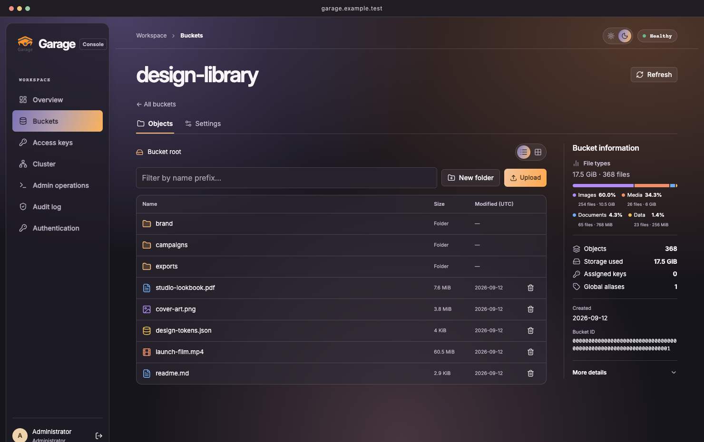

# Garage Admin

A self-hosted web console for [Garage S3 object storage](https://garagehq.deuxfleurs.fr/). Browse a bucket like a file explorer, set CORS rules for a web app, and see which buckets are approaching their storage quotas. Built with TypeScript, Next.js and Bun, tested against Garage **2.1.0**.

[](https://github.com/GmBeHappy/garage-admin/actions/workflows/container.yml) [](https://github.com/GmBeHappy/garage-admin/pkgs/container/garage-admin) [](LICENSE)



## What you can do

- **Browse objects** in list or grid view, navigate folders, upload files, and inspect file types by storage used. Click a file for an isolated preview of images, browser-supported media, PDFs, text, Office excerpts, or ZIP contents.
- **Configure buckets** with CORS presets, lifecycle rules, website documents, quotas, aliases, and per-key permissions. The bucket list shows storage usage against configured limits.
- **Administer a cluster** with node capacity, partition health, layout details, and the Garage v2.1 admin operation catalog.
- **Control access** with an administrator password or OIDC group membership. Signed-in administrators can reveal access-key secrets. Console sign-ins, secret reveals, and admin operations are recorded in a searchable audit log.

## Getting started with Docker

You need a running Garage 2.1 cluster, its Admin API token, a dedicated Garage S3 key and secret, and Docker Compose **2.30 or later**. The example assumes Garage runs on the same Docker host. Keep the Admin API reachable from the console over your private network.

**1. Get the Compose file.** These commands create a directory containing only the deployment files.

```sh
mkdir garage-admin && cd garage-admin
curl -fsSLo compose.yaml https://raw.githubusercontent.com/GmBeHappy/garage-admin/main/compose.yaml
```

**2. Create your server configuration.** This generates a session secret and initial administrator password. Replace the three `REPLACE_ME` values with your Garage credentials. Set the region to Garage's configured `s3_region`.

```sh
umask 077
cat > console.env <<EOF_ENV
CONSOLE_URL=http://localhost:3000
SESSION_SECRET=$(openssl rand -hex 32)
ADMIN_PASSWORD=$(openssl rand -hex 24)
GARAGE_ADMIN_URL=http://garaged:3903
GARAGE_TOKEN=REPLACE_ME_WITH_GARAGE_ADMIN_TOKEN
S3_ENDPOINT=http://garaged:3900
S3_REGION=garage
S3_KEY=REPLACE_ME_WITH_ACCESS_KEY_ID
S3_SECRET=REPLACE_ME_WITH_SECRET_ACCESS_KEY
EOF_ENV
```

The console uses its Admin API token to grant its dedicated S3 key read, write, and owner access to buckets that administrators open. Give console access only to people who should administer the cluster.

**3. Connect to Garage's network and start the console.** The example uses the `garage_default` Docker network and the `garaged` hostname. Substitute your network and Garage service name if they differ. Both URLs in `console.env` must be reachable **from the container**.

```sh
export GARAGE_NETWORK=garage_default
docker compose pull
docker compose up -d
```

Open [localhost:3000](http://localhost:3000) on the Docker host and sign in with the value of `ADMIN_PASSWORD` in `console.env`. The first dashboard load checks connectivity to Garage. For remote use, put the console behind an HTTPS reverse proxy and set `CONSOLE_URL` to the exact browser origin. The sample binds the web port to loopback.

**Data and updates.** The `console-data` volume stores the SQLite audit log and sign-in policy at `/app/data/audit.sqlite`. Preserve this volume and `console.env` across upgrades. To update, run `docker compose pull && docker compose up -d`. For repeatable deployments, replace `latest` in the Compose file with a published commit tag or image digest.

## Sign in with OIDC

Register a confidential OpenID Connect client in your identity provider and set the exact redirect URI to `https://YOUR-CONSOLE-HOST/auth/callback`. Configure the provider to include a `groups` array in the ID token, restrict the application to your admin group, and append these values to `console.env`.

```dotenv
CONSOLE_URL=https://YOUR-CONSOLE-HOST
OIDC_ISSUER=https://YOUR-IDP/application/o/garage-admin/
OIDC_CLIENT_ID=garage-admin
OIDC_SECRET=YOUR_CLIENT_SECRET
OIDC_ADMIN_GROUP=garage-admin
```

Keep one `CONSOLE_URL` entry in the file. Recreate the container with `docker compose up -d`, sign in through OIDC, then open **Authentication → Console sign-in** to enable **SSO only**. Enabling it revokes existing password sessions.

## Container builds

GitHub Actions builds and smoke-tests native **Linux amd64 and arm64** images on pull requests. On a push to `main`, it publishes a multi-platform image tagged `latest` and `sha-<full-commit>`. Git tags matching `v*.*.*` also get a matching image tag.

```sh
docker pull ghcr.io/gmbehappy/garage-admin:latest
```

To build locally, clone this repository and run `docker build -t garage-admin:local .`. To run from source, use `bun install --frozen-lockfile`, `bun run typecheck`, and `bun run build`. Export the server environment variables above, then run the standalone server from the Docker image or use `bun run dev` for development.

## License

The original console code is distributed under the [MIT License](LICENSE). The bundled Garage API specification, Garage artwork and third-party components retain their upstream terms. See [third-party notices](THIRD_PARTY.md).
